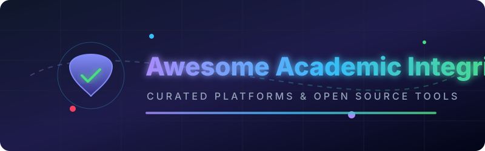

# Awesome-Academic-Integrity

  

  

## 🔍 Similar Projects to Academic Integrity Platforms

Welcome to the **Awesome Academic Integrity** repository—a comprehensive, curated directory of tools, platforms, and libraries for plagiarism detection, code similarity checking, and originality verification. Whether you are an educator preventing academic dishonesty, a student looking to check your work, or a researcher exploring text similarity, this guide covers both commercial SaaS products and open-source equivalents.

### 🏷️ Keywords & Quick Links
`plagiarism checker` • `code similarity detector` • `academic integrity` • `AI content detector` • `source code plagiarism` • `originality checking` • `JPlag` • `Dolos` • `Turnitin alternatives`

**Academic Integrity Platforms** (plagiarism detection / originality checking tools) help educators, publishers, and institutions detect copied or unoriginal content in student papers, research articles, and code submissions. Leading commercial tools include Turnitin, Ouriginal, Copyleaks, SafeAssign, Compilatio, Unicheck, PlagScan, StrikePlagiarism, Urkund, and Originality.ai.

Below is a **curated list** of notable platforms and their open-source equivalents. Fully featured commercial systems with massive proprietary academic databases are difficult to replicate in pure open source. The strongest open-source coverage exists for **source-code plagiarism detection**, while text-based tools rely on local corpora, web search, or open academic indexes.

## 🏢 SaaS / Hosted Platforms

| Platform | Description | Pricing Plan | Free Tier / Limits | Company Size (Valuation / Revenue) |
| :--- | :--- | :--- | :--- | :--- |
| **[SafeAssign](https://www.blackboard.com/)** | Integrated plagiarism checking tool within Blackboard Learn. | Included with Blackboard LMS license | None | ~$3.0 Billion (Parent Valuation) |
| **[Turnitin](https://www.turnitin.com/)** | The dominant academic integrity platform used by universities worldwide for plagiarism detection, AI writing detection, and grading tools. | Custom institutional pricing | None | $1.75 Billion (Valuation) |
| **[Ouriginal](https://www.ouriginal.com/)** | European-focused plagiarism detection solution popular in higher education (formerly Urkund). | Custom institutional pricing | None | ~$15 Million (Est. Revenue) |
| **[Unicheck](https://unicheck.com/)** | Cloud-based similarity checking platform (note: some services have evolved or been discontinued/merged). | Custom institutional pricing; individual packages start at $5.00 for 20 pages | None | ~$10 Million (Est. Revenue) |
| **[Copyleaks](https://copyleaks.com/)** | AI-powered plagiarism and AI-content detection platform with API access. | Starts at $9.16/mo (billed annually for 1,200 pages / 300k words) | Free trial with ~20 credits (~5,000 words / 10 pages) upon signup; no permanent free tier | ~$7.5 Million (Est. Revenue) |
| **[PlagScan](https://www.plagscan.com/)** | Plagiarism detection tool previously popular in education (status may vary by region). | Individual plans from $5.99 for 6,000 words | Free trial of 2,000 words (20 credits) upon signup; no permanent free tier | ~$5 Million (Est. Revenue) |
| **[Urkund](https://www.urkund.com/)** | Classic plagiarism detection service (now part of Ouriginal / larger portfolios). | Custom institutional pricing (merged with Ouriginal) | None | ~$5 Million (Est. Revenue) |
| **[Compilatio](https://www.compilatio.net/)** | Plagiarism detection service widely used in French-speaking and European institutions. | Custom institutional pricing; individual credits start at €2.50 | None | ~$3.5 Million (Est. Revenue) |
| **[Originality.ai](https://originality.ai/)** | AI content and plagiarism detection focused on content publishers and SEO. | Subscription starts at $14.95/mo (3,000 credits/300k words) or pay-as-you-go ($30 for 3,000 credits) | 3 free scans per day (300-word limit per scan) | ~$2.5 Million (Est. Revenue) |
| **[StrikePlagiarism](https://strikeplagiarism.com/)** | Plagiarism detection system used in several countries. | Pay-per-document (approx. €2.50 per document) or custom institutional subscription | None | ~$2.0 Million (Est. Revenue) |

## 🔓 Open-Source Software

### 💻 Source Code Plagiarism Detection (Strongest Open-Source Area)
- **[JPlag](https://github.com/jplag/JPlag)**  — State-of-the-art open-source tool for detecting source code plagiarism and collusion. Supports many languages (Java, C/C++, Python, JavaScript, TypeScript, Go, Kotlin, etc.). Fully local processing — no code is uploaded.
- **[Dolos](https://github.com/dodona-edu/dolos)**  — Modern open-source source code plagiarism detector from Ghent University. Offers an intuitive web interface, interactive visualizations, and support for many programming languages (MIT).
- **[copydetect](https://github.com/blingenf/copydetect)**  — Lightweight Python tool based on the Winnowing algorithm (same family as Stanford MOSS). Generates HTML similarity reports.
- **[AC2](https://github.com/manuel-freire/ac2)**  — Source code plagiarism detection tool with multiple similarity algorithms and strong visualization features.
- **[jieplag](https://github.com/thu-cs-lab/jieplag)**  — High-performance plagiarism detection tool written in Rust, inspired by Stanford MOSS. Supports multiple languages.
- Stanford **MOSS** (Measure of Software Similarity) — Long-standing free academic service (not fully open-source) that many open-source tools are inspired by or re-implement.

### 📄 Text / Document Plagiarism Detection
- **[Noplag](https://noplag.com/)** — Open-core plagiarism checker with an auditable open-source detection engine (Apache 2.0). Supports self-hosting of the engine and multilingual checking.
- Various open-source text similarity tools based on TF-IDF, cosine similarity, or fingerprinting (e.g., text-matcher, simple plagiarism checkers on GitHub).
- Research projects such as **PlagiarismGuard** that aggregate open academic databases (OpenAlex, Semantic Scholar, CrossRef) for similarity analysis without proprietary corpora.

### 🛠️ Supporting Approaches & Libraries
- Fingerprinting and winnowing libraries that power many of the above tools.
- Local corpus comparison scripts using NLP techniques (spaCy, scikit-learn, etc.).
- Integration of open academic search APIs for web-scale checking in self-hosted setups.

### 🎯 Typical Open-Source Approach
- **For programming courses** → JPlag, Dolos, or copydetect (excellent accuracy and fully local).
- **For general text** → Combine open-source similarity engines with institutional document repositories or open academic indexes.
- **For AI-generated content** → Emerging open models and detectors (still maturing compared with commercial AI detectors).

Open-source tools give full transparency and data control, which is especially valuable for institutions concerned about student privacy or vendor lock-in.

---

**🤝 How to contribute**  
Fork this repository, add a new project (with link + short description + category), and open a pull request.  
Prefer actively maintained open-source projects for plagiarism detection, code similarity, or academic integrity tooling.

**⚖️ License**  
This list is public domain / CC0. Feel free to copy into your own awesome list or README.

Star the projects you find useful — open academic integrity tooling helps keep education fair and transparent! 📝

##  Star History

<a href="https://www.star-history.com/?repos=ishandutta2007%2FAwesome-Academic-Integrity&type=date&legend=bottom-right">
<picture>
<source media="(prefers-color-scheme: dark)" srcset="https://api.star-history.com/chart?repos=ishandutta2007/Awesome-Academic-Integrity&type=date&theme=dark&legend=bottom-right" />
<source media="(prefers-color-scheme: light)" srcset="https://api.star-history.com/chart?repos=ishandutta2007/Awesome-Academic-Integrity&type=date&legend=bottom-right" />

</picture>
</a>

